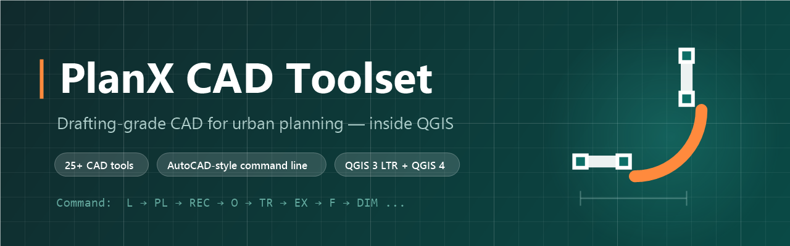

<div align="center">



# PlanX CAD Toolset

**Drafting-grade CAD for urban planning — inside QGIS.**

[](https://github.com/YusufEminoglu/PlanX-CAD/releases)
[](LICENSE)
[](https://qgis.org)
[](https://plugins.qgis.org/)
[](https://github.com/YusufEminoglu/PlanX)

Type `L` ↵, draw a line. Type `F` ↵, fillet a corner.
**30+ CAD tools, an AutoCAD-style command line, and road-platform design — without ever leaving QGIS.**

[Install](#-installation) · [Tools](#-tool-catalog) · [Command line](#-autocad-style-command-line) · [Urban tools](#-urban-planning-tools) · [Shortcuts](#-keyboard-shortcuts)

</div>

---

## ✨ Why PlanX CAD?

| | |
|---|---|
| ⚡ **Muscle-memory friendly** | AutoCAD-style command aliases (`L`, `PL`, `TR`, `F`, `CO`…), empty-Enter repeats the last command, Up/Down recalls history — a real command loop. |
| 📐 **Drafting-grade picking** | A true 10-px pickbox with snap markers, hover highlighting, and self-pick protection in two-step tools (Fillet/Trim/Extend). |
| 🏙️ **Built for planners** | Interactive road platform generator, junction topology fixer, and block-corner chamfering — tools you won't find in generic CAD plugins. |
| 🌍 **Global by design** | A concise English-only workbench, documentation set, command palette, and output schema built for international teams. |
| 🧩 **Zero friction** | Pure QGIS API — no external dependencies, no build step. One dockable panel, native snapping, works on **QGIS 3.28 LTR through QGIS 4**. |

Developed with feedback from educational workflows at **Dokuz Eylül University, Department of City and Regional Planning**.

---

## 🛠 Tool Catalog

### Draw

| Tool | Command | Shortcut | Notes |
|---|---|---|---|
| Line | `L` | `Ctrl+Shift+L` | Click-click, Enter to finish |
| Polyline | `PL` `PLINE` | `Ctrl+Shift+P` | Backspace undoes last vertex |
| Rectangle | `REC` | `Ctrl+Shift+R` | Two-corner |
| Polygon | `POL` | `Ctrl+Shift+G` | N-vertex closed ring |
| Circle | `C` | `Ctrl+Shift+C` | Centre + radius |
| Arc | `A` | `Ctrl+Shift+A` | 3-point arc |
| Construction line | `XL` / `RAY` / `SEG` | `Ctrl+Shift+K` | Infinite / ray / segment reference, dashed cyan layer |

### Modify

| Tool | Command | Shortcut | Notes |
|---|---|---|---|
| Offset | `O` | `Ctrl+Shift+O` | Side-aware parallel copy |
| Multi-offset | `MO` `MOFF` | `Ctrl+Shift+X` | N offsets in one pass |
| Trim | `TR` | `Ctrl+Shift+T` | Click the side to remove |
| Extend | `EX` | `Ctrl+Shift+E` | To nearest boundary intersection |
| Fillet | `F` | `Ctrl+Shift+F` | Radius arc + auto-trim, live hover preview |
| Buffer | `B` | `Ctrl+Shift+B` | Attribute-preserving |
| Hatch | `H` | `Ctrl+Shift+H` | Parallel/cross/diagonal pattern fill, export-safe attributes |
| Divide | `DIV` | `Ctrl+Shift+U` | Equal-length segmentation |
| Join | `J` | `Ctrl+Shift+J` | Weld touching polylines |
| Vertex edit | `VE` | `Ctrl+Shift+V` | Drag to move, click to insert, right-click to delete |

### Transform

| Tool | Command | Shortcut |
|---|---|---|
| Move | `M` | `Ctrl+Shift+M` |
| Copy | `CO` `CP` | — |
| Rotate | `RO` | — |
| Scale | `SC` | — |
| Mirror | `MI` | — |
| Array (rect + polar) | `AR` | `Ctrl+Shift+Y` |

All transforms are **multipart-, curve-, and Z/M-safe** — holes, multi-rings,
CircularString/CompoundCurve geometry, elevations, and measures survive.

### Measure & Annotate

| Tool | Command | Shortcut | Notes |
|---|---|---|---|
| Distance | `DI` `DIST` | `Ctrl+Shift+I` | Snap-aware running total |
| Area | `AA` `AREA` | — | Polygon area on canvas |
| Measure by selection | — | — | Length/area totals of selected features |
| Linear dimension | `DIM` | `Ctrl+Shift+D` | Permanent dimension layer with distance attributes + labels |

---

## ⌨ AutoCAD-style Command Line

The dock's search box **is** a command line:

```text
Command:  L ⏎          → Line starts
Command:  ⏎            → finishes the active sketch; repeats the last command when idle
Command:  ↑ / ↓        → recall command history
Command:  fil…         → autocomplete popup suggests Fillet
Command:  500000,4250000 → absolute point in the map canvas CRS
Command:  @10,0        → 10 metres east of the previous/base point
Command:  @25<45       → 25 metres at 45 degrees
Command:  12.5         → 12.5 metres along the current cursor bearing
```

Resolution precedence: **alias → exact tool key → fuzzy name match**. Unknown commands echo a clear message instead of failing silently. There is also a global **command palette** (`Ctrl+Alt+P`) with category filtering and usage-based ordering.

While a drawing or transform tool is active, type a number, `-`, or `@` directly on the canvas to move focus to the command line without breaking the current operation. Precision point entry is available for Line, Polyline, Rectangle, Circle, Polygon, Arc, Move, and Copy. Rotate accepts a signed angle in degrees; Scale accepts a positive factor. Relative, polar, and direct-distance values are always metres, even when the project uses a geographic CRS; absolute `x,y` values use the canvas CRS.

---

## 🏙 Urban Planning Tools

| | |
|---|---|
| 🛣 **Road Platform Generator** | Interactive road cross-section design: draw an axis, configure carriageway and lane widths, and generate ready road-platform linework. |
| ➕ **Junction Topology Fixer** | Solves X/T/skew road corners with a selectable metric Chamfer or tangent Fillet, exact curb trims, and gap-free connections. |
| 🔲 **Block Chamfering** | EasyFillet-powered corner rounding for urban blocks — one click per corner. |

---

## 📦 Installation

**From QGIS Plugin Hub** *(recommended)*
> `Plugins → Manage and Install Plugins…` → search for **PlanX CAD Toolset** → Install.

**From ZIP**
> Download the latest `planX_CAD_arac_Seti.zip` from [Releases](https://github.com/YusufEminoglu/PlanX-CAD/releases), then `Plugins → Install from ZIP`.

**From source** *(development)*
```text
git clone https://github.com/YusufEminoglu/PlanX-CAD.git
set QGIS_PLUGINPATH=<clone parent dir>   →  restart QGIS
```

| Requirement | Value |
|---|---|
| QGIS | **3.28 LTR → 4.x** (PyQt5 **and** PyQt6 verified) |
| Dependencies | None — pure `qgis.core` / `qgis.gui` / `qgis.PyQt` |
| License | [GPL-3.0](LICENSE) |

---

## ⌨ Keyboard Shortcuts

<details>
<summary><b>Full shortcut map (click to expand)</b></summary>

### Tools — `Ctrl+Shift+…`

`L` Line · `P` Polyline · `R` Rectangle · `G` Polygon · `C` Circle · `A` Arc · `O` Offset · `T` Trim · `E` Extend · `F` Fillet · `B` Buffer · `M` Move · `Y` Array · `V` Vertex edit · `H` Hatch · `K` Construction line · `D` Dimension · `I` Measure · `U` Divide · `X` Multi-offset · `J` Join · `Space` Repeat last tool · `S` Focus command line · `/` Shortcut guide

### Workflow — `Ctrl+Alt+…`

`P` Command palette · `E` Toggle editing · `C` Cancel active tool · `F` Preflight checks · `Q` Quick start · `H` Docs · `D` Diagnostics · `W` Health check · `T` Usage stats · `R` Reset workspace · `Y` Shortcut audit · `G` Session checklist · `N` Issue template · `V` Release readiness

</details>

---

## ♿ Quality & Accessibility

- **Screen-reader complete** — every interactive dock control exposes `accessibleName`/`accessibleDescription`; tool buttons are tab-focusable with a visible focus ring.
- **Dual-runtime verified** — a static 12-check smoke gate (`py -3 tests/smoke_compat.py`, no QGIS needed) locks Qt5/Qt6 enum safety, metadata, English-only release surfaces, pick-aperture behaviour, and import discipline on every release.
- **Real QGIS runtime gates** — lifecycle, geometry-regression, and urban-workbench suites run headlessly on both QGIS 3 LTR/Qt5 and QGIS 4/Qt6 before release.
- **Metre-accurate everywhere** — distance-based CAD and road tools use a local metric work CRS, so a 5 m offset remains 5 m even when the source layer is EPSG:4326.
- **Guardrails everywhere** — writable targets enter edit mode automatically; missing, incompatible, or truly read-only targets get guided status messages instead of silent failure.

## 🧩 Part of the PlanX ecosystem

This plugin belongs to a growing open-source QGIS ecosystem for urban planning by the same author:

| Planning & analysis | CAD & production | 3D & visualization |
|---|---|---|
| [PlanX](https://github.com/YusufEminoglu/PlanX) — spatial-planning suite | [PlanX CAD Toolset](https://github.com/YusufEminoglu/PlanX-CAD) — drafting-grade CAD | [PlanX 3D City](https://github.com/YusufEminoglu/planx_3d_city) — Three.js city viewer |
| [GeoStats Lab](https://github.com/YusufEminoglu/planx_geostats) — spatial statistics | [EasyFillet](https://github.com/YusufEminoglu/EasyFillet) — tangent-arc fillet | [3D OSM Model](https://github.com/YusufEminoglu/osm_3d_model) — OSM → 3D city in browser |
| [Suitability Lab](https://github.com/YusufEminoglu/planx_suitability_lab) — raster MCDA | [Settlement Toolset](https://github.com/YusufEminoglu/PlanX-Settlement) — 9-stage settlement plans | [OSM Quick 3D](https://github.com/YusufEminoglu/osm_quick_3d) — OSM → native QGIS 3D |
| [DataCube Lab](https://github.com/YusufEminoglu/planx_datacube) — spatiotemporal cubes | [UIP Toolset](https://github.com/YusufEminoglu/PlanX-UIP) — master-plan automation | [Urban Procedural 3D](https://github.com/YusufEminoglu/planx_urban_procedural_3d) — parametric zoning lab |
| [Urban Resilience](https://github.com/YusufEminoglu/planx_urban_resilience) — 28 resilience tools | [ParcelFlux](https://github.com/YusufEminoglu/parcelflux) — parcel subdivision | [CartoLab](https://github.com/YusufEminoglu/planx_cartolab) — publication cartography |

---

## 🤝 Contributing & Support

- 🐛 **Bugs / requests** → [Issues](https://github.com/YusufEminoglu/PlanX-CAD/issues) — the in-plugin **Issue Template** dialog (`Ctrl+Alt+N`) pre-fills diagnostics for you.
- 📜 **Changelog** → [CHANGELOG.md](CHANGELOG.md) follows *Keep a Changelog*.
- ✅ Before a PR: run `py -3 tests/smoke_compat.py` (12 static checks, including the English-only release gate), then run all `tests/smoke_*` runtime suites with both `python-qgis-ltr.bat` and `python-qgis.bat`.

## 👤 Author

**Yusuf Eminoğlu** — urban planner & developer
[GitHub](https://github.com/YusufEminoglu) · yusuf.eminoglu@deu.edu.tr

<div align="center">
<sub>Built with ❤️ for the planning classroom and the drafting desk. If PlanX CAD saves you time, a ⭐ helps others find it.</sub>
</div>
